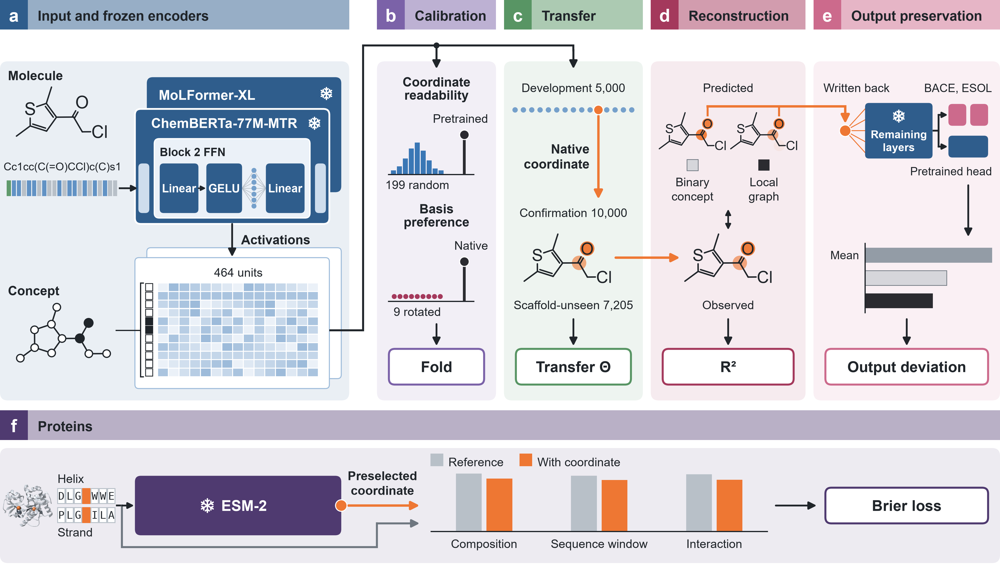

# NCCal

Code, data and figures accompanying **NCCal: testing native chemical coordinates in pretrained molecular models with dual-reference calibration and local-graph reconstruction**, by Yue Zhang.



## Scope of this release

This release covers cross-model dual-reference calibration, fixed-coordinate transfer and fitted local references, five-control clamping, local-graph reconstruction and pretrained-head replacement for the original two coordinates, the ESM-2 fitted-reference comparison, and the recorded post hoc lineage, scaffold, rotation and dose-sensitivity analyses.

The two-encoder coordinate-panel analysis (Supplementary Section S-M) and BACE/ESOL task-head replacement (Supplementary Section S-N) are represented by final artwork only (Figures 4c, 5c, 5d, S-M1 and S-N1); their analysis code, inputs and result archives are not included. Numerical results are reported in the Supplementary Information. For the verified-anchor recalibration in Supplementary Section S-L, this release includes population-eligibility materials; the recalibration code and numerical result archives for Tables S-L1 and S-L2 are not included.

Internal process records written during the study (run locks, receipts and the Chinese-language protocol originals) are not part of this release; English translations of the protocols are in `docs/`, and the recorded execution deviations are described in [docs/DEVIATIONS.md](docs/DEVIATIONS.md). For release, machine-specific paths were removed from some text files and four working folder names were replaced in code and documentation; no numerical value was changed.

## Repository layout

| Folder or file | Contents |
| --- | --- |
| `acquisition/` | Source URLs, sizes and checksums for upstream molecular and model resources. |
| `assets/` | ESM-2 configuration and tokenizer files, and source metadata for the ChemBERTa model and tokenizer. |
| `data/` | Molecular cohorts, atom concepts, mapping anchors and ordered inputs. |
| `docs/` | English analysis protocols and recorded execution deviations. |
| `figure_source/` | Renderer and saved image tiles for Figures S-C2–S-C5. |
| `figures/` | The 18 final figures used in the manuscript and Supplementary Information. |
| `frozen_results/` | Saved cross-model comparison summaries and best-lift vector archives. |
| `intake/` | The original molecular-pool exclusion materials. |
| `cross_model_comparison/` | Saved cross-model and post hoc comparison results and supporting caches. |
| `models/` | Recorded comparison environment, download log and model source materials. |
| `protocols/` | Cross-model comparison design record. |
| `reproduction/` | Protein replay, saved molecular outputs and omitted-input inventory. |
| `results/` | Fixed-coordinate, protein, sensitivity, reconstruction and replacement results. |
| `scripts/` | Cross-model comparison and molecular/protein analysis code. |
| `source_data/` | Saved numerical values and labels for the figures. |
| `third_party_licenses/` | Licenses for included third-party materials. |
| `README.md` | Release scope, manuscript map and quick checks. |
| `FIGURES.md` | Figure panels and their numerical sources. |
| `figure_manifest.json` | Machine-readable figure and source-data inventory. |
| `WORKFLOWS.md` | Protein replay, saved molecular outputs and molecular workflow instructions. |
| `CROSS_MODEL_COMPARISON.md` | Cross-model comparison, saved vectors and decision-rule replay. |
| `ENVIRONMENT.json` | Recorded software versions for the saved-data replay. |
| `requirements-legacy.txt` | Software environment for the cross-model comparison. |
| `requirements-chemistry.txt` | Software environment for the molecular analysis. |
| `requirements-protein.txt` | Dependencies for the saved-data protein replay. |
| `requirements-figures.txt` | Additional packages for the Figures S-C2–S-C5 renderer. |
| `OFFLINE_SMOKE.json` | Recorded offline check of the saved results. |
| `RIGHTS.md` | Redistribution terms and attribution. |
| `LICENSE` | License for the first-party code. |
| `.gitattributes` | Repository file-handling settings. |
| `.gitignore` | Local work directories and generated files ignored by Git. |

## Paper-to-repository map

| Manuscript sections | Display items | Repository paths |
| --- | --- | --- |
| *Dual-reference calibration*; *Native-axis alignment across molecular checkpoints* | Table 2; Figure 2; SI S-A, S-B, S-C, S-F | `scripts/cross_model_comparison/`, `data/derived/cross_model_comparison/`, `frozen_results/cross_model_comparison/`, `cross_model_comparison/results_posthoc/`; [comparison guide](CROSS_MODEL_COMPARISON.md) |
| *Fixed-coordinate transfer and fitted input references*; *Transfer of locked coordinates to new molecules and unseen scaffolds*; label-prediction comparison in *Local-graph reconstruction and conditional label-prediction value* | Figure 3a,c; Figure 4a; SI S-D | `scripts/fixed_coordinate_analyses/chem_*.py`, `data/fixed_coordinate_analyses/chemistry/`, `results/fixed_coordinate_analyses/chemistry_D/`, `results/fixed_coordinate_analyses/chemistry_T/` |
| *Frozen-model output interventions*; full-clamp results in *Output preservation under coordinate replacement* | Figure 5b, full-clamp components; Figure S-E1; SI S-E | `scripts/fixed_coordinate_analyses/chem_D_secondary.py`, `scripts/fixed_coordinate_analyses/chem_T_intervention.py`, `results/fixed_coordinate_analyses/chemistry_D/secondary/MECHANISM_D_PLAN.json`, `results/fixed_coordinate_analyses/chemistry_T/secondary/mechanism/` |
| *Local-graph reconstruction and coordinate replacement*; reconstruction results in *Local-graph reconstruction and conditional label-prediction value*; replacement results in *Output preservation under coordinate replacement* | Figure 4b,d,e; Figure 5a; SI S-J | `scripts/reconstruction_and_replacement/`, `results/reconstruction_and_replacement/`, `reproduction/chemical_replacement_outputs.tar.gz` |
| *Protein fitted-reference extension*; *Case study* | Figure 6; SI S-G | `scripts/fixed_coordinate_analyses/protein_*.py`, `results/fixed_coordinate_analyses/protein_D/`, `results/fixed_coordinate_analyses/protein_T/`, `reproduction/protein/` |
| Post hoc sensitivity analyses, including scaffold-unseen transfer and dose matching | Figure 3b; Figure 5b, paired-dose open symbols and matched-dose marker/range; Figures S-I1 and S-J1; SI S-I | `scripts/sensitivity_analyses/`, `results/sensitivity_analyses/`; S-J1 also uses the full-clamp results in `results/fixed_coordinate_analyses/chemistry_T/secondary/mechanism/` |
| Supplementary only | SI S-H, *Additional computational specifications*: seeds, thresholds, tie-breaking, lookup and cross-validation specifications | Text specifications in the Supplementary Information; implementations in `scripts/cross_model_comparison/`, `scripts/fixed_coordinate_analyses/` and `reproduction/protein/` |
| Supplementary only | SI S-K, *What the measured comparisons imply in practice*; Table S-K1 | Text/table explanation in the Supplementary Information; no separate numerical analysis archive |
| Verified-anchor sensitivity reported in *Native-axis alignment across molecular checkpoints* | SI S-L, *Atom mapping and preactivation geometry in the ChemBERTa comparison*; Tables S-L1 and S-L2 | Atom-anchor eligibility only: `scripts/sensitivity_analyses/a_h4_mapping.py`, `results/sensitivity_analyses/mapping/`. Recalibration code and numerical result archives for Tables S-L1/S-L2 are not included in this release; values are in the Supplementary Information. |
| *Coordinate replacement in molecular prediction tasks*; *Reconstruction across fixed coordinate panels*; *Output fidelity on molecular prediction tasks* | Figure 4c; Figure 5c–d; Figures S-M1, S-N1; SI S-M, S-N | Analysis code, inputs and numerical result archives are not part of this release. Final artwork is provided; numerical results are in the Supplementary Information. |
| All figures | Final artwork, available source data and rendering materials | `figures/`, `source_data/`, `figure_manifest.json`; [figure guide](FIGURES.md) |

## Quick checks

From the repository root, with Python 3.11 or later:

```sh
python scripts/cross_model_comparison/companion.py smoke
```

The smoke check uses only the Python standard library and checks the saved results for completeness. For the protein replay, use Python 3.11 and `requirements-protein.txt`:

```sh
python reproduction/protein/unpack_inputs.py --output-root replay-inputs
python reproduction/protein/replay_protein.py --project-root . --input-root replay-inputs --output-dir replay-output --chemistry-python /path/to/python
```

Use new empty input and output directories. Set `/path/to/python` to an existing Python interpreter; this argument supplies installed-package metadata. See [WORKFLOWS.md](WORKFLOWS.md#executable-protein-replay) for details.

| Requirements file | Purpose |
| --- | --- |
| [requirements-protein.txt](requirements-protein.txt) | Saved protein-data and kernel-readout replay |
| [requirements-chemistry.txt](requirements-chemistry.txt) | Molecular development/confirmation analyses |
| [requirements-legacy.txt](requirements-legacy.txt) | Cross-model comparison environment recorded in `models/ENV_neuroaudit_freeze.txt` |
| [requirements-figures.txt](requirements-figures.txt) | Rendering Figures S-C2–S-C5 from saved results |

## Data sources and redistribution

Molecular records come from PubChem; protein records come from UniProt. Selected records and derived results are included. Pretrained weights, the full PubChem snapshot, and large activation caches are obtained separately. For ChemBERTa tokenizer and configuration files, the repository provides source information. See [RIGHTS.md](RIGHTS.md), [the external-asset inventory](acquisition/EXTERNAL_ASSETS.json), and [the omitted-input inventory](reproduction/OMITTED_INPUTS.json).


## Names used in files

File names, lower-level folder names and some column values keep the short codes used during the study. The READMEs in `scripts/`, `results/`, `data/`, `docs/`, `reproduction/` and `source_data/` explain the short codes used in those folders. Path strings inside result files and inside the two archives keep the working folder names used during the study; `scripts/README.md` lists the four pairs.

## Reproducibility scope

Verified on the released files: the offline smoke check and the saved-data protein replay, which reproduces the saved protein scores to within 4.66 × 10⁻¹⁵. Beyond the omitted activation caches and model weights, a full molecular rerun requires additional study materials outside this release, including the original protocols and test modules read by some preparation and readiness steps.

## AI use

Analysis code was written and run with AI coding agents under the author's direction; see the paper's Acknowledgements and Supplementary Information, “Use of AI in executing the study”.

## License

First-party code is licensed under [MIT](LICENSE). First-party data, figures, and documentation are licensed under [CC BY 4.0](https://creativecommons.org/licenses/by/4.0/). Third-party attribution and terms are listed in [RIGHTS.md](RIGHTS.md).

## How to cite

Zhang, Y. *NCCal: testing native chemical coordinates in pretrained molecular models with dual-reference calibration and local-graph reconstruction*. Manuscript.

Zhang, Y. *NCCal: Research Companion*, version 1.0.0. [GitHub repository](https://github.com/zhangyue616/NCCal), [v1.0.0](https://github.com/zhangyue616/NCCal/releases/tag/v1.0.0).
